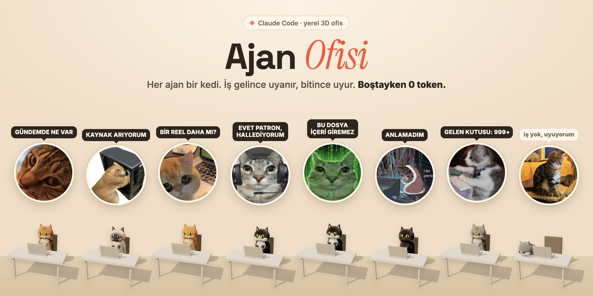

# MyOffice

A local 3D office for Claude Code agents. Each agent is a procedurally modelled animal at a desk: it wakes
up when work arrives, shows what it is doing on its screen, drops its output into a review card and goes back
to sleep. Nothing runs while idle: **0 tokens**.



- **Frontend:** a procedural 3D office built with three.js (no photos, no model files), clickable agents,
  room and agent panels, a live event stream, a token counter, small Web Audio sounds and a demo mode.
- **Backend:** Python standard library only, bound to `127.0.0.1`. It runs agents through `claude -p`.
- **Requirements:** Python 3.10+, [Claude Code](https://docs.claude.com/en/docs/claude-code) (`claude` command)
  and `tmux` (only needed to give work from the office; watching your own sessions works without tmux).
- **License:** PolyForm Noncommercial 1.0.0 — personal, noncommercial use only. See `LICENSE`.

## In plain words (no technical background needed)

MyOffice is a small company of AI helpers that you watch on screen. Every helper is an animal sitting at a desk
in its own room, and each one has one kind of job: researching, teaching, writing, drawing, checking quality,
reviewing security. You only talk to the **CEO**, in everyday language. The CEO decides who should do the work and
hands it over. When a helper finishes, you read the result, and approve it or not.

**What you do, step by step**

1. Open the page and type what you need into the box at the bottom ("Write a blog post about phishing").
2. Watch the right panel: **Working now** shows who is busy and what they are doing.
3. When a card appears under **Needs you**, press **Full result** to read it. Press **Check sources** to see
   whether the CVE numbers and links in it really exist.
4. Press **Approve** when you are happy. Everything stays in the **History** tab.

**What it will never do on its own:** publish, send e-mail, pay for anything, or push code live. Helpers write
drafts; the last step is always yours. Nothing runs while you are away, so an idle office costs nothing, and a
daily limit stops it from using too much AI time. The **Help** button in the page explains all of this again, and
**Settings → Health** tells you in plain words if something is missing.

The sections below are for the person who sets the office up.

## Start in one command

```bash
./start.sh
```

It checks Python, tmux and Claude Code or OpenCode, creates your private `agents.json` from the example on the
first run, installs the OpenCode tool limits, starts the server and opens the browser. Then open **Settings →
Agents**, point every agent at one of your project folders and pick its runtime and model. Check **Settings →
Health** until it is green. (`agents.example.json` ships the full team; the Librarian's folder `.` is this one.)

## Quick try (nothing connected)

```bash
cd frontend && python3 -m http.server 8000
# open: http://127.0.0.1:8000/?demo=1
```

`?demo=1` makes no backend requests: the sample agents in `frontend/demo-data.json` pick up and finish work on
their own. Typing something in the bottom box makes the fake CEO hand it to a matching agent. `?auto=0` turns
automatic runs off, `?light=1` renders at lower resolution with a small shadow. (The frontend uses ES modules,
so opening the file directly with `file://` does not work; the plain server above is enough.)

## Connecting your own agents

1. **Copy the configuration.**

```bash
cp agents.example.json agents.json
cp bridge.example.json bridge.json      # optional: terminal bridge mapping
```

`agents.json` and `bridge.json` are gitignored, so your paths and prompts never enter the repository.

2. **Write `cwd` and your agents.** Point every agent's `cwd` at a real project folder (`~` works), keep
   `allowed_tools` as narrow as possible, and give it only the preset tasks you actually want. An agent whose
   folder is missing counts as "not installed" and is never run.

3. **Register the OpenCode agents (once).** If your agents run on OpenCode, this is what keeps the tool boundary
   real — the office then asks for `office-read`, `office-review`, `office-browse` or `office-write` instead of
   trusting the model:

```bash
python3 scripts/setup-opencode-agents.py     # writes ~/.config/opencode/opencode.json (keeps a .bak)
```

4. **Start the server.**

```bash
python3 server.py            # http://127.0.0.1:8796, next free port when busy (written to ./port)
tmux attach -t office        # watch running agents live (one window per run)
```

5. **Open `http://127.0.0.1:8796`.** Click an agent to give it a preset task, or use the bottom box to tell the
   CEO what you need.

Health check: `./scripts/check.sh` compiles the Python, validates the JSON, syntax-checks the frontend modules,
looks for leftover Turkish text and boots a throwaway server on port 8798 to hit every endpoint.

### The default team

The shipped roster is deliberately small: one desk per kind of work.

| Agent | Room | Can do |
|---|---|---|
| CEO | center | assigns work, no tools, no file access |
| Analyst | Security Operations | reads code and recent changes, reports risks with `file:line` |
| Engineer | Code Room | **reviews** code changes (read-only): verdict APPROVE / CHANGES NEEDED / BLOCKED with `file:line` findings |
| Writer | Writing Room | drafts courses, blogs and reports, a source per claim |
| Marketer | Marketing | social posts and campaign angles (English), drafts only |
| Designer | Design Studio | image prompts, SVG graphics, alt text, platform sizes; creates no raster images |
| Researcher | Research | sourced briefs on vulnerabilities, techniques and news, a link per claim |
| Trainer | Training Studio | lesson plans, lab scenarios with answer keys, quizzes; drafts only |
| QA | Code Room | read-only check that labs and lessons work for a learner, `file:line` reports |
| Coder | Code Room | builds, runs typecheck/lint/build and commits; pushes and deploys **only** from the Ship button |
| Alert Writer | Security Operations | turns fresh real incidents into scenario briefs for the platforms' alert generator (no SQL, drafts only) |
| Librarian | Library | keeps the records: catalogues results, finds what the office already knows, flags duplicates and unreviewed work (read-only) |

Add an agent by appending an entry to `agents.json`. Rooms are derived from the agents: whatever `room` an agent
has is the room it sits in; the CEO room is always in the middle. One agent or thirty both fit the frame.

### Rooms

- **Any number of rooms.** A room id that appears in `agents.json` is opened automatically. `soc` → "Security
  Operations" style names are derived from the id; write the room into the `rooms` list to set `name`,
  `description` and `note` yourself, and the order there sets the order on the scene.
- **Built-in themes:** `ceo`, `writing`, `code`, `design`, `social`, `research`, `end-of-day`, `workshop`,
  `maintenance`, `mail`, `data`. These ids bring their own colour and furniture (shelf, inspiration board,
  server racks…).
- **Desks arrange themselves.** A room widens with its agent count; beyond four desks they form two rows. To
  place a desk by hand, add `"position": {"x": 1.2, "z": 1.2, "stand": true}` to the agent (`x` relative to the
  room centre, `z` depth, `stand` for a raised monitor).

## Architecture

```
browser (frontend/)  ──GET/POST──▶  server.py (127.0.0.1)  ──tmux new-window──▶  runner.py  ──stdin──▶  claude -p
       ▲                                  │   ▲                                    │
       └──────── SSE: events ─────────────┘   └──── events.jsonl ◀── progress, usage, finish ┘
                                          bridge.py (read-only) ◀── ~/.claude/sessions + transcripts
```

### CEO = the main configuration

This folder is the CEO. Project folders are **never moved**; `agents.json` holds each agent's `cwd`, model,
allowed/denied tools and preset tasks. The CEO is a single tool-less `claude -p --json-schema` call: it reads the
request and returns `{"answer": "...", "assignments": [{"agent", "prompt"}]}`. The server validates the JSON
(unknown agent, missing folder, empty/oversized prompt, at most 5 assignments); if it is broken **no run starts**.
An agent with a `trigger_word` (e.g. `mail`) can only be assigned when that word appears in the request.

### One agent = one project folder

An agent runs in its own `cwd` and sits in the room named by its `room` field. The CEO sits in the middle; the
other rooms are laid out around it, and the plinth, lights and camera are computed from that layout.

### Office run: wakes on work, 0 tokens when idle

A button (`POST /api/task`) or the CEO starts a run: the server writes the arguments to `runs/<id>.arg.json` and
opens a new window in the tmux session `office` running `runner.py`. The runner:

- reads the agent config from `agents.json` (never from the argument file);
- embeds `memory/<agent>.md` into the task template and feeds the prompt to `claude -p` on **stdin**;
- writes stream-json to `runs/<id>.log` and drops progress events into `events.jsonl`;
- stores the result in `output/<agent>/<id>.md` and appends the `<memory_add>` block to memory as a dated entry.

The server streams `events.jsonl` to the frontend over SSE. No timer, loop or heartbeat ever calls a model, so an
idle office costs nothing. An agent with `"lean": true` runs without the global CLAUDE.md/rules/MCP, which cuts
context and tokens for small, frequent jobs.

Every run has a watchdog (`"timeout_s"` per agent, 900 seconds by default): when it fires, the runner kills the
whole process group and the run ends as an error, so a hung CLI can never leave an agent "running" forever.

### Who makes it, who checks it

Nothing an agent produces goes unchecked. Every producer has a different agent as its reviewer, and a review starts
by itself when the work finishes successfully. Reviewers are read-only and never review a review.

| Producer | Checked by | What the check looks at |
|---|---|---|
| Coder | Engineer | the real `git diff`: correctness, security, accessibility, anything outside the task |
| Writer | Researcher | every number/CVE/quote against a source; SEO, GEO and tone checklist |
| Marketer | Writer | hook, tone, true and sourced claims, platform fit |
| Designer | Marketer | brand fit, readable on-image text, complete prompts, platform sizes, valid SVG |
| Alert Writer | Analyst | realistic and current scenario, sourced incident, no real victim or working attack detail |
| Trainer | QA | measurable objectives, lab with answer key and safe scope, correct quiz answers |
| Researcher, Marketer, Writer, Designer, Trainer | automatic source check | CVE ids exist, links answer (token-free, shown as a badge) |

The review is its own run (label "Review of Coder's work"), appears as a card under **Needs you**, and sits under
the original run in **History**. Before you press **Ship**, the confirmation shows what the reviewer said.
Set it per agent in `agents.json` with `"reviewed_by": "<agent id>"` and an optional `"review_prompt"`;
**Settings → Health** warns if a reviewer can edit files. `"verify": false` turns the source check off for one agent.

**Revisions.** When a review says `CHANGES NEEDED`, the work goes back to the agent that made it (label "Revision 1
after Analyst's review") with its own result, the review and the original task attached; the revision is reviewed
again. It stops after 2 rounds, on `APPROVE`, and always on `BLOCKED`, and the card then waits for you. The agent is
told to leave findings alone that are wrong or rest on something the reviewer could not see. Reviewers also get the
original task, so a shortfall (19 alerts when 20 were asked) counts as a finding.

**The CEO remembers your last requests** (3, from the last 30 minutes) so a follow-up or a message that was cut off
keeps its numbers and constraints.

**Chaining.** The CEO can order work with `"after"`: "trainer after researcher" starts the trainer when the
researcher finishes and hands it that output (as data, cut at 24,000 characters). Without `after`, assignments
start together. A failed step stops the chain; a follow-up never inherits Ship rights.

### Projects: a big job split into steps

Ask the CEO for something large ("Build a complete beginner course on phishing") and it does not start anything.
It writes a **project** into the Plan tab: 2 to 12 steps, each with an agent, a title and a task. A step waits for
the step before it by default and receives that step's output (a step marked independent starts with the project).
You review the steps, then press **Run next** (starts what is ready) or **Run all** (the office keeps going by
itself). The project stops on its own when a step fails or its reviewer says BLOCKED or CHANGES NEEDED; then you
can open the result, **Accept** it, or **Retry** the step. Progress shows as 3/7 steps. The stepping is plain code
in the scheduler thread, no model; steps never ship; the daily cap and review gates apply to every step.

### Alert Writer: fresh incidents into platform alerts

The training platforms (the platform, the platform) already build alerts themselves: they pick hosts, users and IPs from
their own corporate inventory, keep operating systems consistent and generate the answer playbook. What they lack is
knowledge of what happened in the world last week. The **Alert Writer** supplies that without touching a database:

1. It reads the platform's generator (sector list, campaign packs, how the Scenario Context is used), finds recent
   real incidents (or takes the Researcher's brief) and writes **scenario briefs**: a plain-prose scenario plus the
   settings to choose (sector, difficulty, campaign pack, counts, verdict and severity mix, MITRE ids, sources).
2. `briefcheck.py` validates every brief automatically (plain code): values the generator accepts, counts that add
   up, no IP address or host name in the scenario text, at least one https source with a date. A brief with a
   problem is rejected with the reason; the Analyst reviews the rest.
3. In the result view each usable brief has **Copy scenario**. In the dashboard: Create Alert → Scenario Context,
   choose the listed options, generate. The platform produces valid alerts with its own validation and playbooks.
   No SQL is written and nothing is sent to production by the office.

Use it on its own, or as a project: Researcher (incident brief) → Alert Writer.

### Plan: schedules, planned work and goals

The **Plan** tab holds goals, schedules, planned work and projects, each with an add form (no files to edit).

- **Schedules.** "Every Monday 09:00, Researcher: this week's security news." Pick an agent, a time and the days.
  A plain timer inside `server.py` (checked every 30 seconds, no model) starts the run through the normal
  `start_task`, so the daily token cap, the busy check and the review gates all apply. It runs only while the
  office server is open: a slot that passed more than 15 minutes ago is marked *missed* and is not run later in
  bulk; a busy agent is retried until the 15 minutes are over. A schedule **cannot ship**. Buttons: Run now,
  Pause, Delete. Stored in `state/plan.json` (gitignored).
- **Planned work.** The backlog for development and other jobs: a title, who does it (default Coder) and details.
  Press **Run** and it becomes a normal run with its review and History entry. Each item shows waiting / running /
  done / failed and the reviewer's verdict. Tick **Start by itself when the agent is free** (or press *Start by
  itself* on an item) and the agent takes its oldest such item as soon as it is idle, one per agent per check.
  This is plain code too: it goes through `start_task`, so caps, review gates and "never ship" apply, and an item
  the office cannot start (cap reached, folder missing) stops asking and shows why.
- **Goals.** Why the work exists, in a few words plus one sentence of reasoning ("Launch the SOC course" because
  "first students start in December"). Attach a goal to a schedule, a planned item or a project and the agent
  starts its task with *Goal this work serves: ...*, so it can judge what matters; chained and review runs keep
  the goal, and History shows it. Deleting a goal keeps the work, which just stops carrying it.

Nobody "supervises" the schedule with a model: the timer is plain code, so an idle office still costs nothing.
Results are checked the same way as any other run, by the producer's reviewer.

### History, source checks, shipping and the daily cap

- **History tab.** Every CEO exchange (your question, the answer, the runs it started) and every direct run,
  newest first, with search and an agent filter. Results open in full. Built from `events.jsonl`, `runs/` and
  `output/`; nothing extra is stored. Questions asked before this tab existed were not recorded.
- **Check sources** (button in a result). `verify.py` looks up every CVE id at cve.org and sends a `HEAD` request
  to each `https` link. Links are vetted first (https only, public addresses only, no redirects followed), it
  needs no model and runs only when you press the button. A found CVE proves the id exists, not that the agent
  described it correctly.
- **Shipping is a button, not a permission.** The OpenCode `office-write` agent denies `git push`, deploy
  scripts, `npm publish`, `ssh`/`scp`/`rsync` and `git remote`; `office-review` may only run read-only git
  commands. `office-ship` lifts those limits and is used only for a run started with the **Ship** button (agents
  with the `deploy` profile), after a confirmation. The CEO can never start a shipping run.
  Run `python3 scripts/setup-opencode-agents.py` again after updating, so the rules reach OpenCode.
- **Daily token cap.** `settings.daily_token_cap` in `agents.json` limits the *fresh* tokens (input, output, cache
  writes) the office spends per day; default 2,000,000, `0` turns it off. Cache reads and your own terminal
  sessions do not count. At the cap, new runs and CEO questions are refused until tomorrow. Health warns at 80%.
- **Per-agent budget.** Each agent can also have its own daily limit (Settings, "Daily limit" on the agent's row;
  `daily_token_budget` in `agents.json`; empty or `0` means none). An agent that used up its budget is refused
  until tomorrow while the others keep working, and the Cost tab shows a bar for every agent that has one. The
  office-wide cap still applies on top.
- **Tests.** `python3 -m unittest discover -s tests -v` (offline, no models) covers the CEO plan validation,
  history grouping, source-check safety rules and the localhost-only checks. `./scripts/check.sh` runs them with
  the rest of the health check.

### Terminal bridge: the sessions you opened yourself

`bridge.py` is a 2-second thread in the server and **read-only**: `~/.claude/sessions/<pid>.json` for live
sessions and `~/.claude/projects/<cwd>/<session>.jsonl` for the transcript, tailed by offset so only new lines are
read. **Every session you open shows up in the office**, even without `bridge.json`; that file only decides which
session appears on which agent. Order: `window` (tmux window name) > `cwd` (the folder itself or any parent) >
`default`. Without `default` an unmapped session lands on the first agent; `""` hides unmapped sessions. Sessions
carrying any string from `hide` are never shown. The office's own `claude -p` runs and other non-interactive runs
never fall back to the default.

**Clicking an agent** (or its kitten) opens a "Now" section in the panel: every session bound to that agent, what
it is doing and its subagents (task title, type, model, last tool; last 30 minutes). Subagent data comes from
`<session>/subagents/agent-*.meta.json` plus the transcript tail; message text is never read.

Scope: plain terminal, VS Code / IDE terminal and tmux (`~/.claude/sessions`); the Claude desktop app and other
non-terminal entrypoints (transcript scan).

**My session shows on the wrong agent / not at all:** check the server log. Every unmapped session gets one
`bridge: session not mapped to any agent (cwd=…, tmux window=…)` line with the mapping to add. tmux names an
unnamed window `claude`; if you map by `window`, name the window (`Ctrl-b ,`) or switch to a `cwd` mapping.

Only the **tool name + short target** (file name, search pattern, tool description, first word of a Bash command,
skipping `FOO=bar` assignments), the "got a new task" flag and **usage** numbers reach the event stream. **Message
text, prompts and file contents are never read, stored or logged.** The bridge does not touch Claude Code settings
or hooks.

### Token counter

`token_counter.py` keeps per-agent daily tokens in `state/token-<date>.json`; office runs and terminal sessions are
counted separately, deduplicated by `message.id` (the same message is never counted twice), and records are
replaced rather than appended. Four fields are shown: input, output, cache write and **cache read**. Cache-read
tokens are context re-read every turn (CLAUDE.md, previous messages), not new work, and are billed far cheaper,
but they are usually the biggest number. The cost tab only sums the `total_cost_usd` reported by `claude -p` (API
list price equivalent; not the amount billed on a subscription).

### Models

Every agent runs its own `claude -p --model <model>`; the model lives in `agents.json` per agent (and in
`ceo.model`). The office never picks a model on its own and never calls one while idle. If your Claude Code is
routed through a proxy that maps model aliases, the alias in `agents.json` is what the proxy sees — check that
mapping before expecting `sonnet` and `haiku` to behave differently.

### Settings tab

The **Settings** tab edits the office without touching the file by hand:

- **General** — your name (greeting), brand, a custom greeting line, one line under the welcome summary, and
  whether that summary mentions today's token total and your open terminal sessions.
- **Agents** — name, room, model (alias or full model id) and `lean` per agent. Moving an agent to another room
  moves its desk; the layout is recomputed.
- **Rooms** — display name, description and scene order, plus adding a room or removing an empty one. Room ids are
  permanent because agents reference them, and a room holding agents cannot be removed.
- **Projects** — the folder whose children can be chosen as a task's working directory (default `~/Projeler`).
  The agent panel gets a project picker, and `POST /api/task` accepts `"project": "<name>"`; the server resolves it
  inside that root and refuses anything outside (`GET /api/projects` lists them).

New agents are added from the same tab: id, name, room, folder, model, runtime and a **permission profile**
(`read`, `review`, `build`, `research`, `deploy`). The profile is the only way to grant tools from the browser; an
arbitrary tool list still has to be written into `agents.json` by hand. `deploy` is the only profile that lifts a
global denial: it allows `git push` (and the project's `deploy*.sh`) for that one agent via `denials_override`.
Everything else — publishing, mail, payments — stays forbidden. Adding a room or removing an empty one saves
immediately, and the page reloads so the scene picks the change up.

Every save is written to `agents.json` atomically under a lock, after copying the previous file to
`agents.json.bak`. Rooms only appear on the scene once an agent sits in them; the Rooms tab lists the empty ones
too. `cwd` and tool permissions are deliberately **not** freely editable from the browser: they are the security
boundary and stay a file-level decision outside the profiles above.

### Runtime: Claude Code or OpenCode

An agent runs on `claude -p` by default. Set `"runtime": "opencode"` (or pick it when adding an agent) to run the
same task through the OpenCode CLI instead:

```
opencode run --model <provider>/<model> "<prompt>"
```

The prompt still goes in as one argv element, never through a shell. The runner reads OpenCode's `--format json`
events, so tool calls appear in the live stream and tokens/cost are read from `opencode session export` (a
single-step answer emits no usage event of its own). `--auto` is added only for agents whose tool list includes
`Write`/`Edit`. Everything else — tmux window, output file, memory block, event stream, token counter — behaves
the same as a Claude Code run. Pick the runtime per agent in **Settings → Agents**.

Tool permissions on the OpenCode runtime are enforced by the four agents the setup script installs
(`office-read`, `office-review`, `office-browse`, `office-write`, `office-ship`); the runner maps an agent's tool list onto one of
them. Without those agents the runner still works but falls back to OpenCode's default permissions, so run the
setup script. `claude -p` keeps using `allowed_tools` / `default_denied_tools` as before.

Two things differ on the OpenCode runtime:

- **Shell rules are pattern-based.** OpenCode's `permission.bash` globs (last match wins) are what the setup script
  uses: reviewers get read-only git, builders cannot push or deploy. An agent's `Bash(...)` entries in
  `allowed_tools` are *not* matched one by one on this runtime; the four-agent boundary is.
- **The CEO stays tool-less** through the `ceo` agent defined in this folder's `opencode.json`
  (`"tools": { "*": false }`), so a plan-only call really cannot read or run anything.

**Using Gemini or another provider.** There is no separate Gemini runtime: run it through OpenCode. Connect the
provider in OpenCode (`opencode auth login`), find the model id with `opencode models`, and enter it as the agent's
model in **Settings → Agents** (for example `google/...` or `openrouter/google/...`). **Settings → Health** checks
that every model id really exists.

Some `opencode-go/*` models require a Global region setting in the provider workspace; if a run fails with
`This Go model requires Global regions`, use the same model from another provider — for example
`opencode/deepseek-v4.1-flash` or `deepseek/deepseek-flash`.

The office talks to the `opencode` CLI directly, so it works without any Anthropic proxy in front of it. The
`claude` runtime is only used when an agent explicitly selects it.

## The office itself

- **Six animals, six ways of sleeping.** `"species": "cat" | "kangal" | "owl" | "raven"` per agent changes head,
  ear and tail proportions plus a beak, and each species has its own sleeping pose (the cat curls up, the owl turns
  its head, the raven tucks its beak, the kangal rests its chin on the desk). Poses and memes keep working for all
  of them because the profile only scales meshes, never the animated nodes.
- **Room colours** come from Settings (one picker per room): the colour paints the wall and rug and lightens the
  floor from the same hue, so a new room never looks off.
- **One screen, three questions.** The header shows a single status pill (running agents + results waiting), the
  side column answers *needs you* → *live* → *today*, and tool chatter stays behind **show tool steps**.
- **Results open in a modal** with the full markdown (`GET /api/output?run=…`), and approved results stay listed
  behind **Show** instead of disappearing.
- **⌘K / Ctrl-K** jumps to the command box; the greeting card is a compact pill that expands on hover.

## API

| Endpoint | What |
| --- | --- |
| `GET /api/agents` | agents + `installed`, `status`, `last_run`, `rooms`, `settings` (cwd and task prompts are not sent) |
| `POST /api/task` | `{"agent": id, "label": "<preset task>"}` or `{"agent": id, "prompt": "..."}` → 202; 409 when busy |
| `POST /api/ceo` | `{"text": "...", "dry": false}` → `{answer, assignments, started, rejected}`; `dry: true` plans only |
| `GET /api/events?last=N` | SSE; replays the last N events, then streams live |
| `GET /api/terminals` | sessions from the bridge (agent, room, session name, status, last tool, last target, subagents) |
| `GET /api/tokens` | today's tokens per agent |
| `GET /api/counter` | today's run count, active agents, per-run duration/usage/cost |
| `GET /api/memory` | entry count and the last 3 entries of every `memory/<agent>.md` |
| `GET /api/output?run=<id>` | the full markdown of a finished run (used by the result modal) |
| `GET /api/projects` | folders under the projects root that a task may run in |
| `GET /api/settings` | greeting/brand card options, rooms and per-agent name/room/model/lean |
| `POST /api/settings` | same shape, saved into `agents.json` (atomic, `.bak` backup, validated) |

## Security notes

- **`127.0.0.1` only.** `Host` and `Origin` headers are accepted only for localhost/127.0.0.1 (defence against
  DNS rebinding and requests from other sites). Do not expose the server on `0.0.0.0` or publish it.
- **The prompt never becomes a shell string.** Commands are built as argument lists and the prompt goes to
  `claude` on stdin. Agent ids are whitelist-matched (`^[a-z0-9-]{1,40}$`), room ids allow letters/digits/`_`/`-`
  up to 40 characters, input is capped at 4000 characters and bodies at 16 KB.
- **Outside content = data.** The task template and the CEO prompt hand user requests and file/web/mail content
  over as labelled data; "do this" sentences inside them are not instructions. That alone is not a defence: the
  real limit is keeping `allowed_tools` narrow.
- **Default denials are added to every agent:** reading `.env`, `rm`, `git push`, `curl`, `open`.
- **Only the `engineer` agent can write**, only inside its own `cwd`, and never with `git push`.
- **Sending mail, publishing and spending money stay with the user.** No agent gets those permissions; output is
  a draft, and approval happens through the "CEO asks" card.
- The frontend prints agent text with `textContent` (never interpreted as HTML).
- Working data (`events.jsonl`, `state/`, `runs/`, `output/`, `memory/*.md`) is gitignored; keep it out of the repo.

## Files

| File | What |
| --- | --- |
| `server.py` | HTTP + SSE server, CEO call, run dispatch |
| `runner.py` | one agent run (inside a tmux window) |
| `bridge.py` | terminal bridge (read-only) |
| `token_counter.py` | daily token counter |
| `common.py` | paths, agent table, event log |
| `agents.example.json`, `bridge.example.json` | empty templates |
| `CLAUDE.md` | CEO constitution template |
| `frontend/` | `index.html` (scene + panels), `cat.js` (procedural animals), `settings.js` (settings tab), `meme.js` (meme poses), `portrait.js` (panel avatars), `decor.js` (room props), `demo-data.json` |
| `frontend/preview.html` | dev aid: renders the animals big (`?species=owl,raven,kangal,cat`, `?pose=curl`) |
| `scripts/check.sh` | syntax, JSON, leftover-Turkish sweep and an endpoint smoke test on a throwaway port |
| `scripts/setup-opencode-agents.py` | installs the four `office-*` OpenCode agents (one-time, idempotent) |

## License

PolyForm Noncommercial 1.0.0. In short:

- ✅ Download it, run it on your own machine, connect your own agents.
- ✅ Change the design as you like; share it noncommercially (keeping this licence and the copyright notice).
- ❌ Selling it, shipping it inside a paid product/course/template pack, or installing it for a client as a paid
  service.

Ask on GitHub for commercial use. The binding text is [LICENSE](LICENSE).
